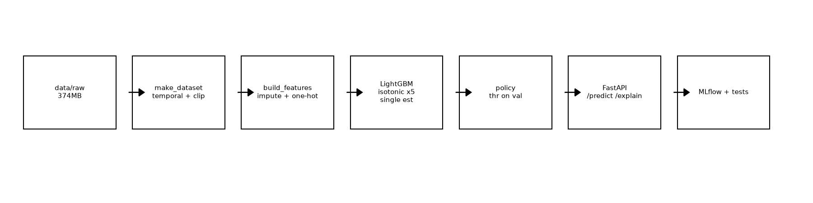
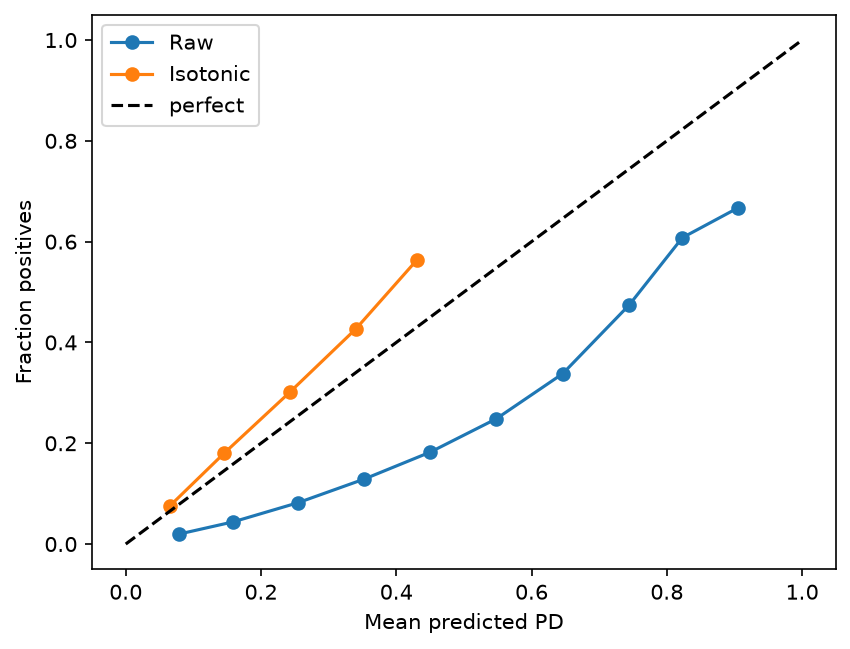
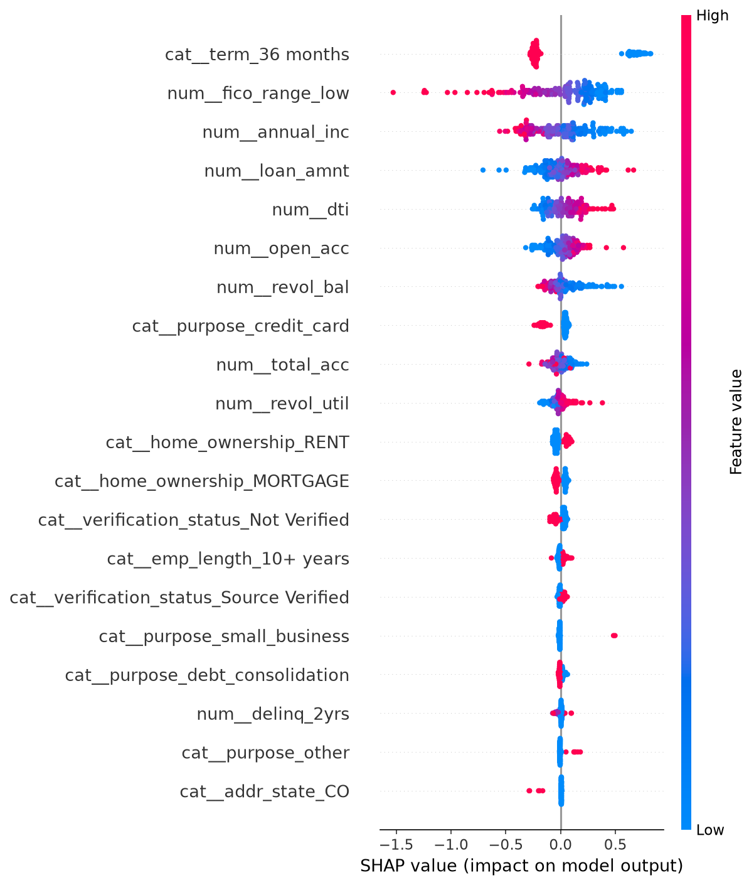

# loan-default-risk -- PD + Profit + SHAP + A/B

[](https://github.com/WHITEJACK5/loan-default-risk/actions)
[](pyproject.toml)
[](LICENSE)
[](https://whitejack5-loan-default-risk.hf.space)
[](#-how-to-run)
[](SECURITY.md)

Batch tabular risk system that predicts probability of default (PD) for LendingClub loans and converts it into a profit-based approve/reject policy, with adverse-action explanations and deterministic A/B assignment.

**Live Demo:** [whitejack5-loan-default-risk.hf.space](https://whitejack5-loan-default-risk.hf.space)
**Repo:** [github.com/WHITEJACK5/loan-default-risk](https://github.com/WHITEJACK5/loan-default-risk) -- **Version:** `2.0.0`

## 🎯 Problem & Scale

2.26M raw LendingClub rows (2007-18Q4) -> **1,345,310** resolved loans after filtering `Current`, `Late` and other unresolved statuses. 151 raw columns -> **24 origination-time features**; every column that only becomes knowable after funding is excluded (see `docs/leakage_audit.md`).

The split is **temporal, not random** -- a random split would let 2018 loans train the model that scores 2018 loans:

| Split | Window | Loans | Default rate |
|---|---|---|---|
| `train` | issued <= 2014 | 451,059 | 17.0% |
| `val` | issued 2015-2016 | 668,640 | 21.5% |
| `test` | issued >= 2017 | 225,611 | 21.3% |

`src/data/validate.py` verifies every split is clean (no non-positive loan amounts, no negative DTI, no null issue year) before training runs.

## 🏗️ Architecture



```
data/raw (375MB)  ->  src/data/make_dataset.py     split + clip to serving bounds
                  ->  src/features/build_features.py   impute + one-hot
                  ->  src/loan_default_risk/modeling.py LightGBM (lender side B)
                  ->  src/models/train.py               isotonic calibration, cv=5
                  ->  src/api/model.py                  digest-verified load
                  ->  src/api/main.py                   /predict /explain /ready
                  ->  src/monitoring/drift.py            PSI on four features
                  ->  Docker + MLflow + Gradio
```

**Lender side B** excludes `grade`, `sub_grade`, `int_rate` and `installment`. Those are *pricing* inputs already set from the same risk the model is scoring, so excluding them gives a view of the applicant's own payment behaviour rather than a re-derivation of the underwriter's grade.

## 📊 Metrics

<!-- METRICS:START -->
| split | n | dr | ROC | Gini | PR-AUC | Brier | KS | Recall_at_5pct |
|---|---|---|---|---|---|---|---|---|
| train | 451059 | 0.1696 | 0.7235 | 0.4471 | 0.3392 | 0.128 | 0.3246 | 0.1625 |
| val | 668640 | 0.2154 | 0.7029 | 0.4059 | 0.3901 | 0.1558 | 0.2898 | 0.1703 |
| test | 225611 | 0.2128 | 0.6866 | 0.3732 | 0.351 | 0.158 | 0.2704 | 0.1335 |
<!-- METRICS:END -->

Measured on `data/processed/*.parquet` by `src/models/train.py`, drawn from `artifacts/metrics.json`. The `val -> test` drop (ROC 0.704 -> 0.687) is the temporal generalisation gap this repo is built to measure.

**Drift (`val` vs `test`, PSI on four continuous features)** -- all stable:

| feature | PSI | band |
|---|---|---|
| `int_rate` | 0.099 | stable |
| `dti` | 0.010 | stable |
| `annual_inc` | 0.002 | stable |
| `revol_util` | 0.094 | stable |

Input distributions hold, so the `val -> test` metric drop is **model** drift, not covariate drift. Regenerate with `python -m src.monitoring.drift`.

## 📸 Results

**Top risk drivers**, mean |SHAP| in log-odds units over the validation window (`scripts/drivers.py`, aggregated by `src/api/explain.py`):

| feature | mean contribution |
|---|---|
| `term` | +0.355 |
| `fico_range_low` | +0.326 |
| `annual_inc` | +0.208 |
| `loan_amnt` | +0.139 |
| `dti` | +0.131 |

`fico_range_high` contributes exactly `0.0000`: on 99.99% of loans `fico_range_high == fico_range_low + 4`, so the two columns carry the same information and LightGBM splits on `fico_range_low` alone. The column is not harmful, but it earns nothing — a candidate to drop rather than a driver to show a customer.





## 🚀 How to Run

```bash
# install (bash)
python -m venv .venv && source .venv/bin/activate
pip install -e ".[dev]"

# install (PowerShell)
python -m venv .venv; .\.venv\Scripts\Activate.ps1
pip install -e ".[dev]"

# 1. data -- download from https://www.kaggle.com/datasets/wordsforthewise/lending-club
#    into data/raw/accepted_2007_to_2018Q4.csv.gz (sha256 in data/README.md)
python -m src.data.make_dataset     # split + clip
python -m src.data.validate         # exits 1 if any split is dirty

# 2. train + evaluate
python -m src.models.train          # calibrated LightGBM + metrics.json
python -m src.models.evaluate       # score the persisted model
python -m src.monitoring.drift      # PSI report

# 3. serve
uvicorn src.api.main:app --port 8000          # http://127.0.0.1:8000/docs
docker build -t ldr . && docker run -p 8000:8000 ldr
docker compose up --build                      # mounts ./artifacts read-only

# 4. verify
pytest                                        # 85 tests, ~12s
ruff check . && ruff format --check .
python -m bandit -r src scripts               # must be clean
python scripts/render_readme.py --check       # exits 1 on metric drift
```

## ⚙️ Configuration

Every knob is an environment variable, read by `src/loan_default_risk/config.py` and validated at import. A typo fails at startup rather than producing a wrong threshold in production.

| Variable | Default | Purpose |
|---|---|---|
| `LDR_THRESHOLD` | `0.05` | approve below this PD |
| `LDR_LGD` | `0.6` | loss given default |
| `LDR_OP_COST` | `500.0` | operating cost per loan |
| `LDR_SEED` | `42` | reproducibility |
| `LDR_MODEL_PATH` | `artifacts/model.joblib` | model binary to serve |
| `LDR_ARTIFACTS_DIR` | `artifacts` | where the model and metadata live |
| `LDR_CORS_ORIGINS` | `*` | comma-separated allow-list |
| `LDR_MAX_BODY_BYTES` | `65536` | request body cap |
| `LDR_LOG_LEVEL` | `INFO` | log verbosity |

## 💰 Cost / Latency

Measured by `scripts/latency.py` on the persisted model, 50 sequential requests:

| quantity | measured |
|---|---|
| model load at startup | 0.92 s |
| RSS after load | 187 MB |
| `/predict` p50 | 29 ms |
| `/predict` p95 | 38 ms |
| `/predict` max | 50 ms |

`/explain` costs materially more because it runs `TreeExplainer`.

**Where the latency went.** The first measurement was **135 ms p50**, and cProfile showed why: sklearn input validation (`check_array`) plus tag resolution (`inspect.getattr_static`) ran the full pipeline five times per request, because `CalibratedClassifierCV(ensemble=True)` keeps one estimator per calibration fold. The pipeline itself is 0.33 ms/row in batch, so a single request paid 130 ms of fixed per-call overhead rather than any real computation.

Switching to `ensemble=False` (`LDR_CALIBRATION_ENSEMBLE=false`, the default) refits a single estimator instead of averaging five folds. Measured on the 668k-row validation window:

| | ROC | Brier | single-row |
|---|---|---|---|
| `ensemble=True` (5 folds) | 0.7038 | 0.1557 | 135.9 ms |
| `ensemble=False` (1 estimator) | 0.7029 | 0.1558 | 26.5 ms |
| **delta** | **−0.0009** | **+0.0001** | **5.13× faster** |

That trade is the reason for the default: 0.0009 ROC is far inside noise on 668k rows, and 5× per-request latency is not. Set `LDR_CALIBRATION_ENSEMBLE=true` to get the out-of-fold calibrator back if you would rather have it.

Training is 5-fold isotonic calibration over 451k rows — minutes, not hours, on CPU with no GPU. **Deployment:** Hugging Face Spaces, free tier.

## 🔐 Security

See [SECURITY.md](SECURITY.md) for the full threat model. The controls that matter:

- **The model binary is digest-verified before it is deserialised.** `src/api/model.py` refuses any path outside the artifacts directory and any file whose SHA-256 disagrees with `artifacts/model_meta.json`. This mitigates pickle-based code execution, which is the highest-severity risk in a sklearn serving path.
- **Input is bounded, not merely type-checked.** `LoanRequest` forbids unknown keys and constrains every field (`dti` in `[0, 50]`, `fico_range_low` in `[300, 850]`), so a payload is rejected with 422 before it reaches the estimator.
- **The Docker context excludes secrets and data.** `.dockerignore` keeps `.git`, `.env*`, `*.pem`, the 375MB archive and `artifacts/` out of the image.
- **No credentials in the repository.** `.gitignore` covers `.env`, `*.pem`, `*.key`, `*.p12`, `*.pfx`, `token.json` and `credentials.json`.
- **No traceback reaches the caller.** Unhandled exceptions return a generic 500 with the request ID; the traceback goes to the log.

## ⚠️ Limitations

- **No authentication or rate limiting.** This is a public demo; deploy behind an ingress that provides both.
- **Lateground fields are clipped, not modelled.** 34,232 training rows had a value outside the serving bounds (DTI below 0, DTI above 50); they are clipped (`src/data/make_dataset.py`), not imputed.
- **LGD is a single fixed 0.6**, not a per-grade estimate.
- **The operating cost is a flat $500**, not a per-loan marginal cost.
- **Single-vintage data.** LendingClub 2007-2018 only; no multi-table bureau data.
- **No protected attributes.** `purpose` and state are proxies at best; the fairness view is not a fair-lending analysis.

## 🗺️ Roadmap

- Real `Postgres` loan store and Redis bucketing for experiment assignment
- Streaming drift detection, so `val -> test` decay triggers retraining
- Per-grade LGD replacing the flat 0.6
- Bootstrap CIs on the profit-per-loan estimate
- Two-hurdle approach for the `Current`/`Default` distinction this model collapses

## 📦 Structure

```
loan-default-risk/
├── src/
│   ├── api/                 main.py, schemas.py, explain.py, model.py
│   ├── data/                make_dataset.py, validate.py
│   ├── experiments/         assign.py, stats.py
│   ├── features/            build_features.py
│   ├── loan_default_risk/   config.py, data.py, modeling.py, provenance.py,
│   │                        tuning.py, validation.py
│   ├── models/              train.py, calibrate.py, evaluate.py, explain_shap.py
│   ├── monitoring/          drift.py
│   └── policy/              evaluate_profit.py
├── scripts/
│   ├── render_readme.py     metrics block + --check drift gate
│   ├── segments.py          per-segment performance from real predictions
│   ├── drivers.py           mean |SHAP| ranking on the validation window
│   └── gen_cis.py           bootstrap confidence intervals (seeded)
├── tests/                   85 tests, conftest.py, fixtures/synthetic.parquet
├── docs/                    leakage_audit, model_card, drift_report, segment
├── artifacts/               model.joblib, model_meta.json, metrics.json
├── space/                   Gradio demo
└── Dockerfile, docker-compose.yml, pyproject.toml, SECURITY.md
```

Generated rather than hand-maintained: `artifacts/metrics.json`, `artifacts/model_meta.json`, `docs/drift_report.md`, `docs/drivers.md`, `docs/segment.md`, and the `<!-- METRICS -->` block in this README. `python scripts/render_readme.py --check` exits 1 if any of them is stale — CI runs it.

## 📄 License

MIT -- see [LICENSE](LICENSE). Author: DEVIREDDY BHARADWAJA REDDY.
